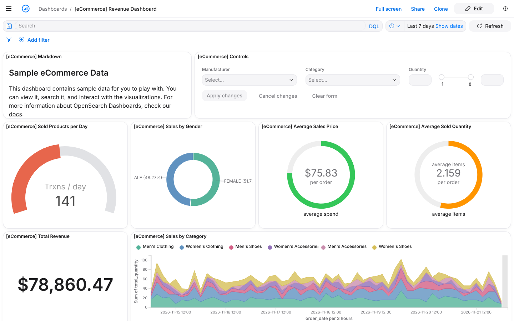
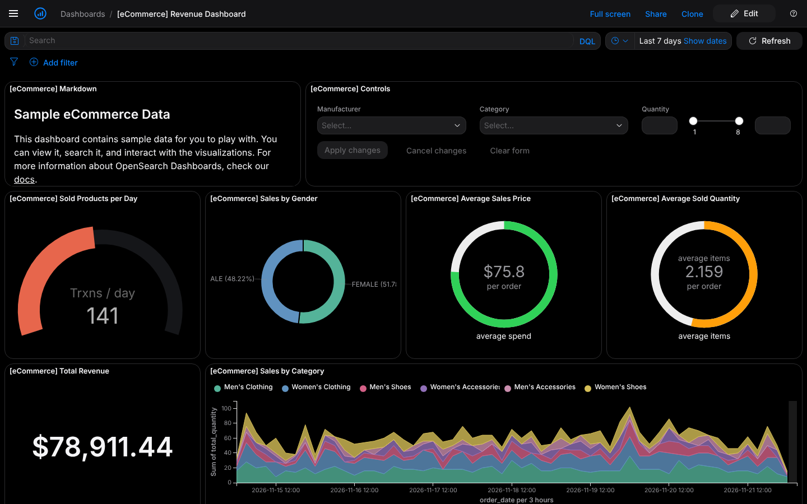
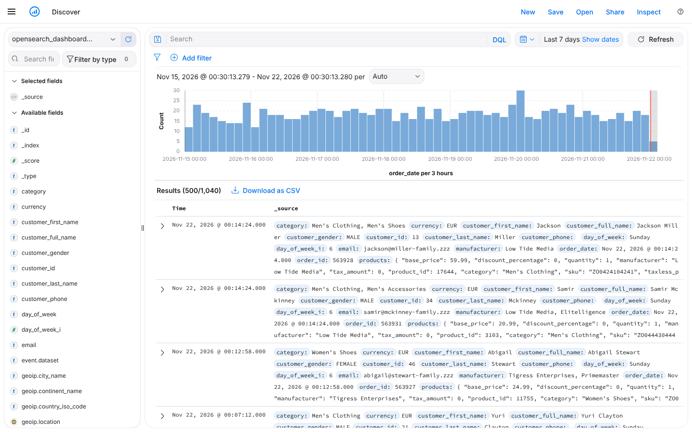
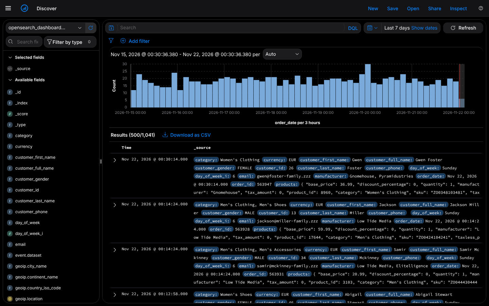

# The distribution

Everything that turns the OpenSearch Dashboards source in this repository into InfraDashboard
lives here, so the upstream tree stays close to what upstream ships.

| Path | What it is |
| --- | --- |
| `branding/brand.json` | The name, the accent and ink colours, the type. The one place to change them. |
| `branding/render_assets.js` | Draws the logos, the loading mark and the favicons from `brand.json`. |
| `plugins.json` | The plugins that ship with it and the ones it leaves out, each pinned to a tag and a commit. |
| `scripts/fetch_plugins.js` | Fetches a pinned plugin into `plugins/` and checks the commit. |
| `scripts/build.sh` | Builds the platform, the plugins and the assembled tarball. |
| `scripts/smoke_test.js` | Checks a running instance: green, the right plugins loaded, open without a sign-in. |
| `config/opensearch_dashboards.yml` | The settings the tarball and the image start with. |
| `config/dev.yml` | Settings for running the source against the development OpenSearch. |
| `docker/Dockerfile`, `docker/entrypoint.sh` | The image. |
| `docker/docker-compose.yml` | The image with a stand-in for the lite backend, to try it. |
| `docker/dev/docker-compose.yml` | An OpenSearch 3.9.0 for `yarn start`. |
| `helm/infradashboard` | The Kubernetes chart. |
| `screenshots/` | What the release image looks like, for this page and for pull requests. Not part of the build. |
| `UPSTREAM.md` | Which upstream files the fork changes, and how to take an upstream release. |

## No sign-in, no permissions

InfraDashboard ships without the security plugin, and so does the backend it is made for, the
lite OpenSearch of `gonzalomunoz1024/opensearch-backend`. There is no sign-in page, no user, no
tenant and no role: whoever can reach the server can read and change everything the OpenSearch
behind it holds, saved objects and data alike. Who reaches it is decided outside the product, by
the network, the Ingress or a proxy in front.

- Nothing of the security plugin is left in the settings, the image, the compose files or the
  chart. A setting of that plugin (`opensearch_security.*`) is unknown to the server and stops it
  at start with a message that names the setting; the chart refuses it when it renders.
- The switches OpenSearch Dashboards has of its own for permissions are off, as they ship:
  workspaces (`workspace.enabled`), permissions on saved objects (`savedObjects.permission.enabled`),
  several data sources with their own credentials (`data_source.enabled`) and the dashboard
  administrators (`opensearchDashboards.dashboardAdmin`). Leave them off.
- The server keeps the protections of a web application that are not about who someone is: the
  `osd-xsrf` header on writes and the content security policy.
- Saved objects are the ones in the `.kibana` index. With the security plugin each tenant had an
  index of its own; what was saved in a private or a custom tenant is not shown here. Export it
  from that tenant (Saved objects, Export) and import it.

## Name and logo

`brand.json` holds the product's name and colours. The mark is a ring with three rising bars,
drawn as a flat glyph in the accent colour like the other Atlas marks.

```bash
node distribution/branding/render_assets.js          # the SVGs
node distribution/branding/render_assets.js --png    # and the favicons, which need a Chromium
node distribution/branding/render_assets.js --check  # fail if a committed file is not what it draws
```

The script writes over the upstream asset files under `src/core/server/core_app/assets`, keeping
their names, so nothing that refers to them has to change. Edit `brand.json` or the script, never
the generated files; the Distribution workflow runs `--check`. The `--png` step uses the
repository's Puppeteer; point `PUPPETEER_EXECUTABLE_PATH` at a Chromium if Puppeteer has none of
its own.

The name is set at two sizes: beside the mark in the header, and as a title in the wide logo that
fills the slot of the OpenSearch wordmark. The wide logo is drawn as wide as the name, so a longer
or shorter name needs no other change.

The name also appears as the default page title in three source files, listed in `UPSTREAM.md`.
A deployment can still set its own name and logos with the `opensearchDashboards.branding`
settings, as in OpenSearch Dashboards.

## The look

The product opens in the Atlas theme, in light or in dark. The theme is a package of its own,
`packages/osd-atlas-theme`; its README says how it is built and how to change it.

| Light | Dark |
| --- | --- |
|  |  |
|  |  |

These are the release image with the sample data.

A person switches to dark in Advanced settings (`theme:darkMode`). To make dark the default, add
to `opensearch_dashboards.yml`:

```yaml
uiSettings.defaults:
  'theme:darkMode': true
```

## Plugins

A plugin's pages talk to a plugin of the same kind in OpenSearch, so InfraDashboard ships a plugin
only if the lite backend has what it needs. `plugins.json` holds two lists, each entry with the
tag and the commit it is built from and, as `backend`, the OpenSearch plugins it needs:

- `plugins`, the ones that ship. They are fetched at build time into `plugins/`, which Git
  ignores; their source is not copied into this repository.
- `leftOut`, the other plugins of the OpenSearch Dashboards 3.9.0 distribution. They are not
  fetched, built or installed, and the smoke test fails if one of them is loaded.

| Ships | Pages | Backend it needs |
| --- | --- | --- |
| `indexManagementDashboards` | Index policies, rollups, transforms, snapshots, index and template management | `opensearch-index-management`, `opensearch-job-scheduler` |
| `queryWorkbenchDashboards` | Query Workbench (SQL and PPL) | `opensearch-sql`, `opensearch-job-scheduler` |

PPL and SQL in Discover are part of the platform, not a plugin; they need `opensearch-sql` too.
The backend plugins named here build on others in turn, most of them on
`opensearch-job-scheduler`, which the lite backend has.

| Left out | Pages | Backend it would need |
| --- | --- | --- |
| `securityDashboards` | Sign-in, users, roles, tenants | `opensearch-security` |
| `alertingDashboards` | Monitors and alerts | `opensearch-alerting`, `opensearch-notifications` |
| `notificationsDashboards` | Notification channels | `opensearch-notifications`, `opensearch-notifications-core` |
| `anomalyDetectionDashboards` | Anomaly detectors and forecasts | `opensearch-anomaly-detection`, `opensearch-job-scheduler` |
| `observabilityDashboards` | Traces, metrics, notebooks, integrations | `opensearch-observability`, `opensearch-sql` |
| `reportsDashboards` | Scheduled and on-demand reports | `opensearch-reports-scheduler`, `opensearch-job-scheduler` |
| `customImportMapDashboards` | Maps | `opensearch-geospatial`, and a map tile server the browser can reach |
| `securityAnalyticsDashboards` | Threat detection rules and findings | `opensearch-security-analytics`, `opensearch-alerting`, `opensearch-notifications` |
| `queryInsightsDashboards` | Slowest queries, live queries | `query-insights` |
| `searchRelevanceDashboards` | Comparing search results | `opensearch-search-relevance` |
| `mlCommonsDashboards` | Deployed machine-learning models | `opensearch-ml` |
| `flowFrameworkDashboards` | Search and ingest flows for AI use cases | `opensearch-flow-framework`, `opensearch-ml` |
| `assistantDashboards` | The chat assistant | `opensearch-ml`, `opensearch-skills` |
| `investigationDashboards` | Investigations (ships switched off upstream) | `opensearch-ml`, `opensearch-skills` |

To bring one back, add its backend to the lite backend, then move its entry from `leftOut` to
`plugins`: the build, the image and the smoke test follow the manifest. Sign-in needs more than
that, because the settings of the security plugin are gone from this directory.

```bash
node distribution/scripts/fetch_plugins.js --list
node distribution/scripts/fetch_plugins.js indexManagementDashboards
```

A fetch fails if the tag no longer points at the pinned commit. To move a plugin to another
version, change its tag and commit together.

A plugin is installed with the defaults its authors gave it. `enabledBy` in the manifest names the
setting that turns on a plugin which ships switched off, and the smoke test accepts such a plugin
being off.

Do not leave a fetched plugin under `plugins/` while `yarn start` runs: the development server
picks it up and stops if the plugin has not been bootstrapped.

## Build

```bash
distribution/scripts/build.sh platform        # target/opensearch-dashboards-3.9.0-linux-x64.tar.gz
distribution/scripts/build.sh plugin <name>   # target/plugins/<name>-3.9.0.zip
distribution/scripts/build.sh plugins         # every plugin, one after another
distribution/scripts/build.sh assemble        # target/infradashboard-3.9.0-linux-x64.tar.gz
distribution/scripts/build.sh all
```

Build the platform first: its build clears `target/`. Each plugin is built with only itself under
`plugins/`, as the upstream release does, because the plugins bring their own dependencies and
cannot all be installed side by side. `ARCH=arm64` builds for arm64.

## Image

```bash
docker build -f distribution/docker/Dockerfile \
  --build-context dist=target --build-arg VERSION=3.9.0 \
  -t infradashboard:3.9.0 distribution/docker
```

The image is laid out like the OpenSearch Dashboards image: the product is in
`/usr/share/opensearch-dashboards`, it runs as user `opensearch-dashboards` (uid and gid 1000),
listens on 5601, and its entrypoint is that image's, which turns environment variables such as
`OPENSEARCH_HOSTS` into settings. A deployment that mounts its own
`config/opensearch_dashboards.yml` or sets those variables keeps working when the image name is
swapped. No registry is set up yet: the build leaves the image on the machine that built it.

The image's own `opensearch_dashboards.yml` holds two settings: where OpenSearch is, and
`opensearchDashboards.branding.useExpandedHeader: false`, which gives the product one header bar
instead of two. The Atlas theme is drawn for the one bar. A deployment that mounts its own file
should carry the second over; without it the product works as before, with a dark upper bar. The
Helm chart sets it. A file written for the OpenSearch Dashboards image has to lose its
`opensearch_security.*` lines before this image starts with it.

`docker/docker-compose.yml` runs the image beside a stand-in for the lite backend: the official
OpenSearch 3.9.0 image with every plugin removed but the three the lite backend has. Point it at
the lite backend's own image once that is in a registry.

## Helm chart

```bash
helm install dashboards distribution/helm/infradashboard \
  --set image.registry=registry.example.com/platform \
  --set opensearch.hosts[0]=http://opensearch-lite:9200
```

The default host is the Service of the lite backend's chart, `http://opensearch-lite:9200`. That
backend's NetworkPolicy lets in the pods labelled `app.kubernetes.io/name: infradashboard`, which
is the label this chart gives its pods.

The chart follows the conventions of the Atlas platform chart: secrets are only referenced by
name, the pod runs as non-root with a read-only root filesystem, and `values.yaml` documents each
setting. A setting that looks like a secret in `config` fails the render.

## Checking a running instance

```bash
node distribution/scripts/smoke_test.js --url http://localhost:5601
node distribution/scripts/smoke_test.js --core-only    # the source, via yarn start
```

The check writes one saved object and removes it again.
